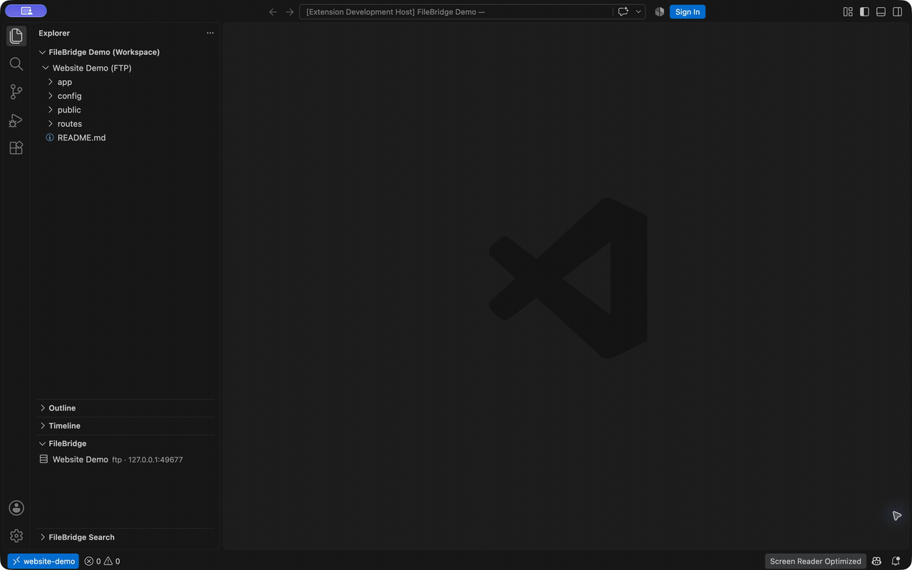
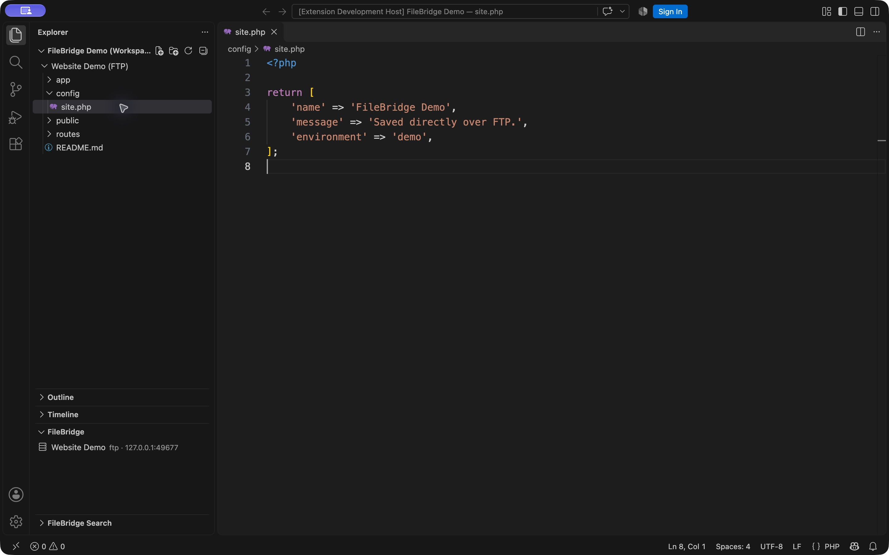
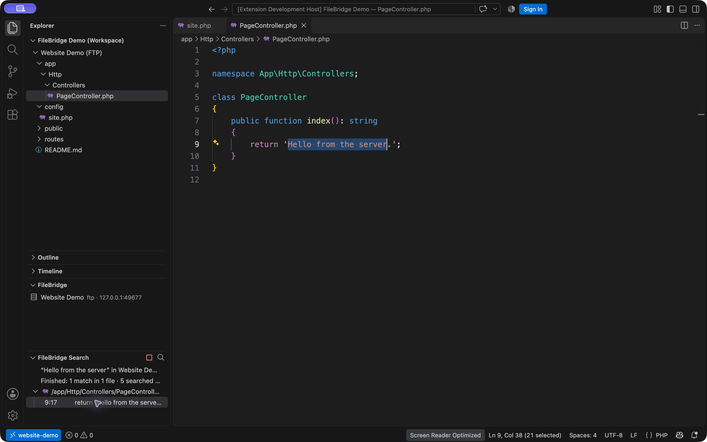

# FileBridge

[Source](https://github.com/webobscure/filebridge) ·
[Report a bug](https://github.com/webobscure/filebridge/issues) ·
[Builds and checks](https://github.com/webobscure/filebridge/actions/workflows/ci.yml)

[Upgrade guide](https://github.com/webobscure/filebridge/blob/HEAD/docs/UPGRADING.md) ·
[Known limitations](https://github.com/webobscure/filebridge/blob/HEAD/docs/LIMITATIONS.md) ·
[Support](https://github.com/webobscure/filebridge/blob/HEAD/docs/SUPPORT.md)

**Your server files, right in your editor.**

Browse remote folders, open files, and save changes directly to your FTP or FTPS
server from VS Code or Cursor. Connect once and work with remote files using the
editor's familiar Explorer and Save command.

Inspired by [Remote FS by liximomo](https://github.com/liximomo/vscode-remote-fs),
FileBridge brings the same direct editing workflow to a modern FTP/FTPS implementation.

[](https://github.com/webobscure/filebridge/blob/HEAD/docs/media/filebridge-demo.mp4)

[Watch the 15-second demo](https://github.com/webobscure/filebridge/blob/HEAD/docs/media/filebridge-demo.mp4).
Recorded in a separate VS Code window against a disposable local FTP server.
The saved file contents were verified on that server.

**Before installing:** desktop VS Code API 1.90+ or compatible Cursor is required.
SFTP/SSH and browser editors are unsupported. Remote search uses FileBridge's
own command, with default limits of 10 MiB per file and 1,000 matches. Remote
folders are virtual workspaces, without full local project synchronization.
The separate PhpStorm plugin is experimental and targets build 262 only.

## Features

- **Remote folders in Explorer.** Open multiple server folders in one workspace.
- **Save directly to the server.** Press `Cmd+S` or `Ctrl+S` to upload your changes.
- **Configure your way.** Use the connection wizard or `remotefs.remote` in `settings.json`.
- **FTP and FTPS.** Connect using passive FTP, explicit TLS, or implicit TLS.
- **Everyday file operations.** Create, rename, and delete files and folders from Explorer.
- **Search remote content.** Find text recursively in unopened FTP/FTPS files, including hidden folders, and jump to a matching line.
- **Flexible password storage.** Use the editor's encrypted storage or an explicit JSON password.
- **Save safeguards.** Upload through a temporary file, detect some external changes,
  and keep unsaved edits in the editor when a save fails.



## Install

1. Open the **Extensions** panel in VS Code or Cursor.
2. Open the `…` menu and select **Install from VSIX…**.
3. Choose `filebridge-0.6.1.vsix`.
4. Open the Command Palette: `Cmd+Shift+P` on macOS or `Ctrl+Shift+P` on Windows/Linux.
5. Run **FileBridge: Add Server**, or configure a connection in JSON as shown below.

FileBridge ships as a VSIX package. Download the `filebridge-release` artifact
from a successful [CI run](https://github.com/webobscure/filebridge/actions/workflows/ci.yml),
or use a published [GitHub Release](https://github.com/webobscure/filebridge/releases)
when available. It is not published to an extension registry. It requires a
desktop editor supporting VS Code API 1.90 or later.

The extension details page should show **FileBridge 0.6.1**, publisher
**Webobscure**, and identifier `Webobscure.filebridge` (case-insensitive).

### Upgrade from an earlier publisher

For a publisher-by-publisher checklist, including the original
`liximomo.remotefs` extension, see the
[complete upgrade guide](https://github.com/webobscure/filebridge/blob/HEAD/docs/UPGRADING.md).

Version 0.5.0 uses publisher Webobscure. It installs as a separate extension from
both previous identities: `remoter-fs-local.remoter-fs` (through 0.3.0) and
`FileBridge.filebridge` (0.4.0). The
`remotefs.remote` setting, internal commands, and remote folder URIs remain compatible.

If all your connections and passwords are in `settings.json`, disable the old
extension, install FileBridge 0.6.1, and reload the editor. Your JSON configuration
will be read by FileBridge directly.

To also keep wizard-created connections and passwords saved in secure storage:

1. Save your open remote files.
2. Install the helper matching the publisher shown on your old extension:
   - **FileBridge** (0.4.0): `filebridge-migration-from-0.4-0.4.1.vsix`.
   - **remoter-fs-local** (through 0.3.0): `filebridge-migration-from-remoter-0.3.2.vsix`.
   Each helper replaces its corresponding old extension and uses that extension's storage.
3. Install `filebridge-0.6.1.vsix` and reload the editor.
4. Wait for **Connections and saved passwords transferred**. If needed, run
   **FileBridge: Transfer Legacy Connections** with the matching source name from the Command Palette.
5. Uninstall **FileBridge Migration Helper** after the success notification.

The helper transfers data directly between extension contexts. It does not write
passwords to files or send them over a network. Imports keep existing connections
and passwords in FileBridge and can be retried. The helper retains the legacy
data until you choose to uninstall it; it does not provide a remote filesystem.
Do not enable the original pre-helper extension alongside the new FileBridge.

For later updates under the Webobscure identifier, install the newer VSIX and
click **Restart Extensions** or **Reload Window** if prompted.

## Connect with settings.json

Run **FileBridge: Open Settings (JSON)** and add your connections under
`remotefs.remote`. The format is compatible with the FTP configuration used by
the original Remote FS extension:

```json
{
  "remotefs.remote": {
    "my-server": {
      "name": "My Website",
      "scheme": "ftp",
      "host": "ftp.example.com",
      "port": 21,
      "username": "my-user",
      "password": "YOUR_PASSWORD",
      "rootPath": "/public_html"
    }
  }
}
```

Save your settings, then select the server in the **FileBridge** section of
Explorer. Its remote folder opens as a workspace folder. You can also run
**FileBridge: Connect** from the Command Palette.

Add more entries to connect to multiple servers. Custom ports, such as `22220`,
are supported. The server list updates when settings change; no editor restart
is needed. Invalid entries appear with a warning while valid connections remain available.

### Connection options

| Option | Description | Default |
| --- | --- | --- |
| `name` | Display name in Explorer. | Connection key |
| `scheme` | `ftp`, `ftps` (explicit TLS), or `ftps-implicit`. | `ftp` |
| `host` | Hostname or IP address, without a protocol prefix or path. | Required |
| `port` | Server port, from 1 to 65535. | `21`, or `990` for implicit FTPS |
| `username` | FTP username. | Required |
| `password` | Plain-text password. Omit to use secure storage. | Secure storage |
| `rootPath` | Absolute folder on the FTP server. | `/` |
| `connectTimeout` | Connection and transfer inactivity timeout, in milliseconds. Minimum: 1000. | `30000` |
| `atomicSave` | Upload to a temporary file, then rename it into place. | `true` |

Settings are supported at user and workspace level. This setting is excluded
from automatic Settings Sync by default. JSON connections appear alongside
connections created with the wizard; they are not copied into wizard storage.
Edit or remove JSON connections in Settings. **Remove Connection** opens Settings
for these entries.

Changing a password reauthenticates the connection on the next operation.
Changing the host, port, protocol, username, or root folder creates a new connection
identity. Reconnect from the server list; existing tabs will not save to the new
destination. Preserve any edits from those tabs before switching.

## Connect with the wizard

Run **FileBridge: Add Server**. Enter a display name, protocol, hostname, port,
username, remote folder, save mode, and password. The remote folder must be an
absolute FTP path, such as `/public_html` or `/`.

Once connected, open a file in Explorer, edit it, and press **Save**. The editor
waits for the server operation to finish. File and folder operations are available
through the standard Explorer context menu.

## Commands

| Command | Action |
| --- | --- |
| **FileBridge: Add Server** | Create a connection with the wizard. |
| **FileBridge: Connect** | Open a server folder or reconnect. |
| **FileBridge: Disconnect** | Close the connection after any active operation finishes. |
| **FileBridge: Refresh Folders** | Reload remote folder listings. |
| **FileBridge: Search Remote Files** | Search server file contents recursively. |
| **FileBridge: Cancel Remote Search** | Stop the current search and keep partial results. |
| **FileBridge: Change Password** | Save a password securely, or open Settings if it is set in JSON. |
| **FileBridge: Open Settings (JSON)** | Open user settings to edit JSON connections. |
| **FileBridge: Remove Connection** | Remove a wizard connection and its saved password, or open Settings for a JSON connection. |

Disconnecting keeps the folder in Explorer so you can reconnect later. Removing
a connection keeps files on the server. Wizard connection details can be changed
by removing and recreating the connection.

## Search remote files

Run **FileBridge: Search Remote Files** from the Command Palette or use the
search button in FileBridge. Select a server, enter the text, and choose
**Ignore case** or **Match case**. To search a specific folder, right-click it
in the remote Explorer and choose the same command. Selecting a file searches
its parent folder.

Results appear in **FileBridge Search**, grouped by remote path. Click a result
to open that file at the matching line. Files do not need to have been opened
before searching. Use **Cancel** in the progress notification or the stop button
in the results panel to stop and retain partial results.

FTP has no server-side content search: FileBridge downloads candidate files one
at a time into memory and searches their server contents. A large project or a
slow connection takes longer. Unsaved editor changes are not included. Search
does not upload files or create a persistent local project copy.

The search is literal text on one line. It supports UTF-8, including UTF-8 BOM
and CRLF. Binary files, other encodings, symbolic links, and files above the size
limit are skipped and counted. Unreadable files/folders appear as warnings;
cancellation, errors, and reaching the result limit are explicitly indicated.
No folders are excluded by default, and the editor's `search.exclude`,
`files.exclude`, and `.gitignore` do not control this separate search.

Optional settings:

```json
{
  "filebridge.search.exclude": ["node_modules", ".git", "storage/logs"],
  "filebridge.search.maxFileSizeMB": 10,
  "filebridge.search.maxResults": 1000
}
```

Exclusions are exact file/folder names anywhere, or paths relative to the chosen
search folder. Excluded folders are not traversed; wildcards are not supported.
Clear the exclusions to visit all folders. The size limit accepts 1–128 MiB and
the result limit accepts 1–50,000 matches. The defaults are 10 MiB and 1,000.

Use FileBridge's command for remote search. The editor's standard `Cmd+Shift+F`
/ `Ctrl+Shift+F` is not connected to the FTP search implementation.



## Passwords and encryption

Passwords entered through the wizard or **Change Password** are stored in the
editor's encrypted **SecretStorage**. An explicit `password` in JSON takes
precedence and is stored as plain text; an empty string sends an empty password.
Keep configuration containing credentials out of source control.

To use secure storage for a JSON connection, omit `password` and run
**FileBridge: Change Password** for that server. VS Code and Cursor use separate
storage, so saved secrets must be entered again when switching editors.

FTPS validates the server certificate. Certificate validation cannot be disabled.
Plain FTP transfers both credentials and file contents without encryption.

## Save modes and recovery

**Temporary upload and rename** is the default. The upload goes to a temporary
file beside the original, then replaces the original by renaming. A failed upload
leaves the original in place. The server must allow temporary files and replacement
by rename. The replacement may change permissions, ownership, or other attributes.

**Direct overwrite** is available for servers where replacement by rename is
unsuitable. Set `atomicSave` to `false` to use it. A failed transfer may leave a
partial file on the server.

Failed saves are reported to the editor, where your edits remain unsaved. Writes
are not retried automatically. Check the connection and save again manually.
A closed connection is reopened on the next request, unless you explicitly used
**Disconnect**, in which case you must use **Connect** first.

Before saving, FileBridge compares the remote file's size and modification date
with the version read when the file was opened. If they differ, saving is blocked
so you can preserve your edits and compare them with the current server version.
This is an additional check, not file locking: changes within the timestamp's
resolution with the same size, and races immediately before rename, may go undetected.

## Current limitations

- Desktop VS Code and Cursor only; browser editions are not supported.
- SFTP/SSH, active FTP, symbolic links, and legacy filename encoding options are not supported.
- FTP does not provide live change notifications. Refresh Explorer to reload
  folders, and reopen a file to load its current server contents.
- Replacing an existing folder during a rename and moving files between servers are not supported.
- Files are loaded into memory. The extension is intended for source files and
  configuration, rather than large archives.
- The configured root controls the visible folder. Server permissions enforce access control.
- Remote folders are virtual workspaces. Git, terminals, build tools, and AI features
  that require local files may be limited. A local project copy is not synchronized.

## Development

See [CONTRIBUTING.md](CONTRIBUTING.md) for cross-platform tests and
[RELEASING.md](RELEASING.md) for versioning, checksums, and automated draft releases.

GitHub Actions tests actual VS Code instances on Windows and Linux with
both 1.90.0 and current stable, and builds/verifies the native PhpStorm plugin.
Hosted macOS Intel checks can be enabled in a manual CI run; the same suite also
runs locally on macOS, including Apple Silicon.
Release packages are assembled only after all checks pass. Reports include the
actual tested editor versions and architectures; see the workflow run for results.

A native **FileBridge for PhpStorm** build is available as
`filebridge-phpstorm-0.2.1.zip`, targeting PhpStorm 2026.2.x. Its sources, build
script, setup instructions, and validation status are in `jetbrains/README.md`.
VS Code/Cursor continue to use the VSIX package described above.

Use Node.js 22 or later:

```sh
npm ci
npm run check
npm test
npm run build
npm run package
```

Build the one-time legacy migration helper with `npm run package:migration`.

To debug, open this project in the editor and launch the **FileBridge** debug
configuration with `F5`.

Integration tests run isolated instances of VS Code and Cursor against local
FTP/FTPS fixtures. They do not connect to your servers or alter your normal
editor profiles:

```sh
python3 -m venv /private/tmp/remoter-fs-test-venv
/private/tmp/remoter-fs-test-venv/bin/pip install pyftpdlib pyopenssl
npm run test:integration
```

By default, the tests use editors installed in `/Applications`. On other systems,
set `REMOTER_TEST_EDITOR`, `REMOTER_TEST_EXECUTABLE`, and `REMOTER_TEST_PYTHON`.
Tests require a graphical session, Python, OpenSSL, and available loopback ports.
Reports and isolated editor profiles are written to a temporary directory.

API references: [VS Code API](https://code.visualstudio.com/api/references/vscode-api),
[virtual workspaces](https://code.visualstudio.com/api/extension-guides/virtual-workspaces),
and [basic-ftp](https://github.com/patrickjuchli/basic-ftp).

Attribution and license notices are included as `NOTICE.md`, `LICENSE`, and
`THIRD_PARTY_NOTICES.txt`.
