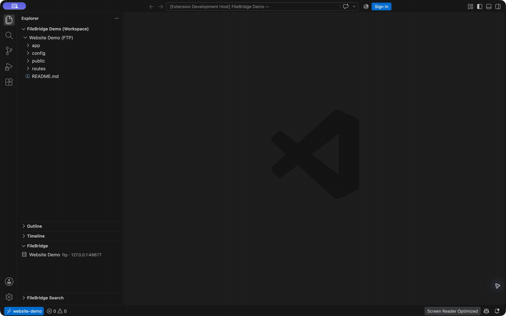

# FileBridge

**Your server files, right in your editor.**

Connect to FTP or FTPS, browse server folders, open a file, and save your edits
directly to the server. FileBridge brings this workflow to desktop VS Code and
Cursor, with secure password storage and recursive remote text search.

[Watch the 15-second MP4](https://github.com/webobscure/filebridge/blob/HEAD/docs/media/filebridge-demo.mp4)

- Open remote folders in Explorer and work with multiple servers.
- Save directly with `Cmd+S` / `Ctrl+S`.
- Search unopened UTF-8 files and jump to a matching line.
- Configure connections with the wizard or familiar `remotefs.remote` JSON.
- Use passive FTP, explicit FTPS, or implicit FTPS.
- Choose secure password storage or an explicit JSON password.

## Get started

Install the current FileBridge VSIX, then run **FileBridge: Add Server** or
**FileBridge: Open Settings (JSON)**. Select your server, open a file in Explorer,
edit it, and save. For content search, use **FileBridge: Search Remote Files**.

## Before installing

Desktop VS Code API 1.90+ or a compatible Cursor build is required. SFTP/SSH and
browser editors are unsupported. Search uses FileBridge's own command and reads
server files over FTP; defaults are 10 MiB per file and 1,000 matches. Remote
folders are virtual workspaces, without full local synchronization. Plain FTP
is unencrypted; FTPS validates certificates. See all
[limits and save behavior](https://github.com/webobscure/filebridge/blob/HEAD/docs/LIMITATIONS.md).

## Upgrading and support

Using an older publisher or the original Remote FS? Follow the
[upgrade guide](https://github.com/webobscure/filebridge/blob/HEAD/docs/UPGRADING.md)
before removing its connection storage.

[Source](https://github.com/webobscure/filebridge) ·
[Support / bugs](https://github.com/webobscure/filebridge/issues/new/choose) ·
[Builds](https://github.com/webobscure/filebridge/actions/workflows/ci.yml)
